<p align="center">
  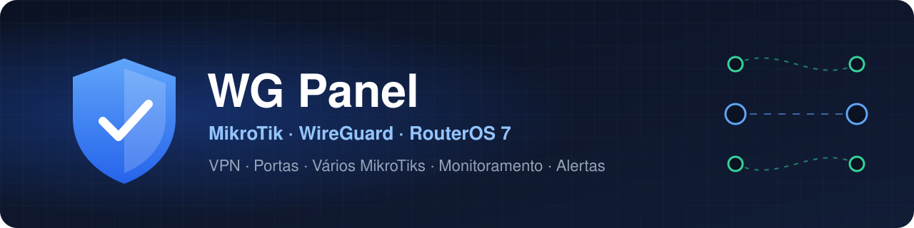
</p>

<p align="center">
  🇺🇸 <a href="README.md">English</a> · 🇧🇷 <b>Português</b>
</p>

<p align="center">
  <a href="../../releases/latest"></a>
  <a href="../../releases"></a>
  <a href="LICENSE"></a>
  <a href="../../stargazers"></a>
  <br>
  
  
  
  
</p>

<p align="center">
  <b>Um painel web para a VPN WireGuard do seu MikroTik.</b><br>
  Crie acessos com QR Code em 1 clique, ligue os MikroTiks dos seus clientes, libere portas para jogos e aplicações<br>
  e acompanhe tudo com alertas no Telegram e no Discord. Roda em <b>Docker</b> ou <b>dentro do próprio MikroTik</b>.
</p>

<p align="center">
  <a href="../../releases/latest"><b>⬇️ Baixar</b></a> ·
  <a href="#escolha-sua-instalação"><b>🚀 Instalar</b></a> ·
  <a href="#-telas"><b>📸 Telas</b></a> ·
  <a href="#3-configurar-a-vpn"><b>🔐 Configurar a VPN</b></a> ·
  <a href="#-segurança"><b>🔒 Segurança</b></a> ·
  <a href="../../discussions"><b>💬 Discussions</b></a>
</p>

<p align="center">
  <a href="docs/screenshots/pt-BR/dashboard.png">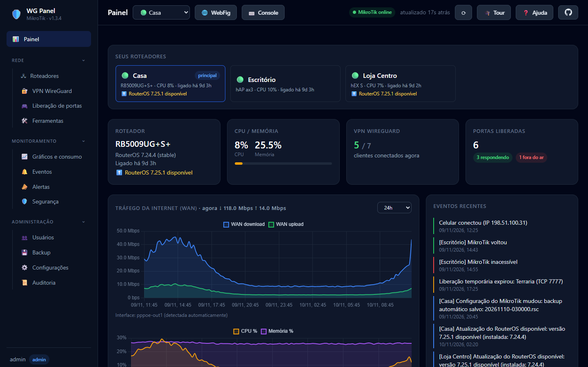</a>
</p>

## ✨ Destaques

<table>
  <tr>
    <td width="33%" valign="top">
      <h3>🔐 VPN em 1 clique</h3>
      Crie o acesso e escaneie o <b>QR Code</b> no celular, ou baixe o <b>.conf</b> para o computador. Usa o DDNS do MikroTik, então funciona de qualquer lugar.
    </td>
    <td width="33%" valign="top">
      <h3>🖧 Vários MikroTiks</h3>
      Ligue o roteador de um cliente colando um script e gerencie todos no mesmo painel, com um <b>usuário limitado</b> que só entra pelo túnel.
    </td>
    <td width="33%" valign="top">
      <h3>🎮 Liberação de portas</h3>
      Modelos prontos (Minecraft, CS2, Valheim, Plex…), whitelist de IPs e <b>liberação temporária</b> que fecha sozinha.
    </td>
  </tr>
  <tr>
    <td width="33%" valign="top">
      <h3>📈 Monitoramento</h3>
      Quem está online, tráfego e consumo por cliente, CPU e memória do roteador e teste se o servidor está no ar.
    </td>
    <td width="33%" valign="top">
      <h3>📣 Alertas</h3>
      <b>Telegram</b> e <b>Discord</b>: cliente conectou ou caiu, MikroTik offline, RouterOS novo, configuração mudou.
    </td>
    <td width="33%" valign="top">
      <h3>🛡️ Seguro por padrão</h3>
      Só mexe no que ele mesmo criou (<code>[wgpanel]</code>), confere a segurança de cada roteador e registra quem fez o quê.
    </td>
  </tr>
</table>

> ⚠️ **Segurança: nunca exponha o painel na internet.** Acesse só pela rede local ou pela VPN. Veja o passo a passo em **[🔒 Segurança](#-segurança)**.

> 💬 Tem uma ideia ou dúvida? Use a aba **[Discussions](../../discussions)**. Encontrou um problema? Abra uma **[Issue](../../issues/new/choose)**. O botão com o ícone do GitHub, no topo do painel, leva direto para cá.

## 🧩 Tudo o que ele faz

| Módulo | O que faz |
|---|---|
| 🔐 **VPN WireGuard** | Configuração inicial guiada, criação de clientes com 1 clique, **QR Code** para celular, download do **.conf** (sempre pelo IP fixo/DDNS, funciona de qualquer lugar), modo "só rede local" ou "toda a internet", ativar/desativar, regenerar chaves, **importar peers que já existem no MikroTik** (chaves guardadas no roteador → QR funciona em qualquer painel) |
| 🖧 **Vários MikroTiks** | Gerencie o seu MikroTik e os dos clientes no mesmo painel: seletor no topo, tela **Roteadores** com status de todos e alertas com o nome de cada roteador. O MikroTik de um cliente entra pelo túnel com um **usuário limitado** (`wgpanel`, senha aleatória, login só pelo túnel) criado pelo próprio script — sem reaproveitar senhas de admin |
| 🖧 **Outro MikroTik (site-to-site)** | Várias interfaces WireGuard (ex.: `wg-casa` e `wg-clientes`); túnel com o MikroTik de um cliente informando a rede dele, com **➡️ só eu acesso** (padrão) ou **↔️ mão dupla**; o painel cria peer, rotas e regras no seu MikroTik e gera um **script .rsc** para colar no MikroTik do cliente; monitoramento e alerta se o cliente cair |
| 🎮 **Liberação de portas** | Port forward com **modelos prontos** (Minecraft, CS2, Valheim, Palworld, Rust, ARK, FiveM, Plex…), TCP/UDP/ambos, faixas de portas, **whitelist de IPs**, **liberação temporária** (fecha sozinha), detecção de conflito com regras existentes |
| 📈 **Monitoramento** | Quem está online, último handshake, IP de origem, tráfego por cliente, consumo por período, tráfego por porta liberada, **teste se o servidor está no ar**, CPU/memória/WAN do roteador, gráficos com histórico |
| 🌐 **WebFig e Terminal** | Botão **🌐 WebFig** em cada roteador (e no topo) abre a página do MikroTik — com o **Terminal** — numa nova aba, com o seu próprio login. Para clientes, funciona pelo túnel |
| ⌨️ **Console de comandos** | Botão **⌨️ Console** ao lado do WebFig (no topo e em cada roteador): roda comandos no MikroTik e mostra a resposta, sem sair do painel. Usa o usuário limitado `wgpanel`, só administradores usam e cada comando fica na **Auditoria** |
| 🛠️ **Ferramentas** | **Ping** e **traceroute** feitos pelo próprio MikroTik (o seu ou o de um cliente): ele alcança o cliente da VPN, o servidor, a internet? |
| 🛡️ **Checagem de segurança** | Confere em cada roteador os erros mais comuns — port forward para o painel, firewall de entrada ausente, serviços abertos, usuário `admin` padrão, DNS aberto — com o comando para corrigir cada um. Só lê |
| ⬆️ **Atualização do RouterOS** | Pergunta a cada roteador uma vez por dia se há RouterOS novo, mostra nos cartões dos roteadores e avisa no Discord/Telegram |
| 🔔 **Versão nova do painel** | Consulta o GitHub uma vez por dia; quando sai versão nova, mostra **⬆️ vX.Y.Z disponível** no menu lateral, um ponto no botão do GitHub e avisa no Discord/Telegram |
| 📖 **Manual e tour** | Manual completo dentro do painel, tour guiado e ajuda contextual (❓) em cada tela |
| 🌐 **9 idiomas** | Português (Brasil), English, Español, Français, Deutsch, Italiano, Русский, 中文, 日本語 — telas, tour, manual, erros e alertas. Segue o idioma do navegador; troque na tela de login, no menu lateral ou em Configurações |
| 📣 **Alertas** | Telegram e Discord: cliente conectou/desconectou, serviço caiu/voltou, regra sumiu do MikroTik, porta temporária expirou, MikroTik offline, atualização do RouterOS disponível, configuração mudou — no idioma que você escolher |
| 👥 **Usuários** | Vários usuários: **administrador** ou **somente leitura** |
| 💾 **Backup** | Exporta/importa tudo do painel (JSON), cria backup `.backup`/`.rsc` dentro do MikroTik e faz **backup automático diário/semanal** da configuração de cada MikroTik, guardando **só quando algo mudou**, com o **O que mudou** para comparar |
| 📜 **Auditoria** | Registro de quem criou, alterou ou removeu o quê, e quando |

> **Segurança:** o painel só altera o que ele mesmo criou (tudo leva o comentário `[wgpanel]`). Suas regras atuais do MikroTik **não são tocadas**.

---

## 📸 Telas

> Dados de demonstração (roteadores, clientes e IPs fictícios). O painel também fala English, Español, Français, Deutsch, Italiano, Русский, 中文 e 日本語.

<p align="center"><a href="docs/screenshots/pt-BR/dashboard.png"></a><br><sub><b>Painel</b> — todos os seus roteadores, CPU/memória, clientes VPN conectados, tráfego da WAN e eventos recentes</sub></p>

<table>
  <tr>
    <td width="50%" valign="top"><a href="docs/screenshots/pt-BR/vpn.png">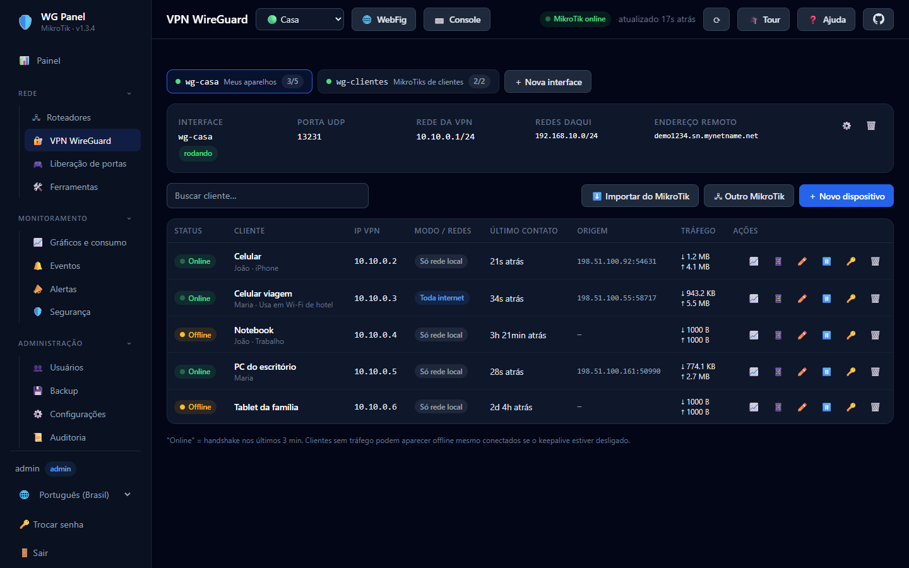</a><br><sub><b>VPN WireGuard</b> — clientes com status, último contato, IP de origem e tráfego; várias interfaces em abas</sub></td>
    <td width="50%" valign="top"><a href="docs/screenshots/pt-BR/qrcode.png">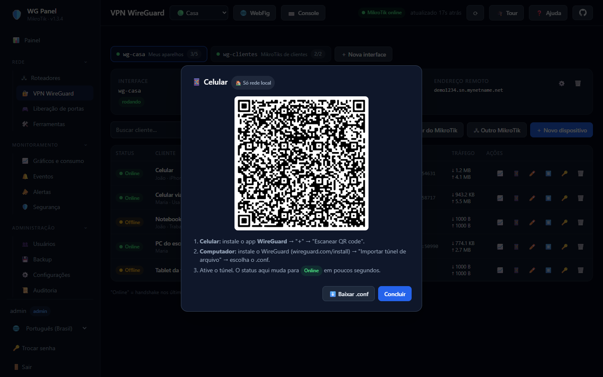</a><br><sub><b>QR Code</b> — escaneie com o app WireGuard; funciona de qualquer lugar pelo DDNS</sub></td>
  </tr>
  <tr>
    <td width="50%" valign="top"><a href="docs/screenshots/pt-BR/routers.png">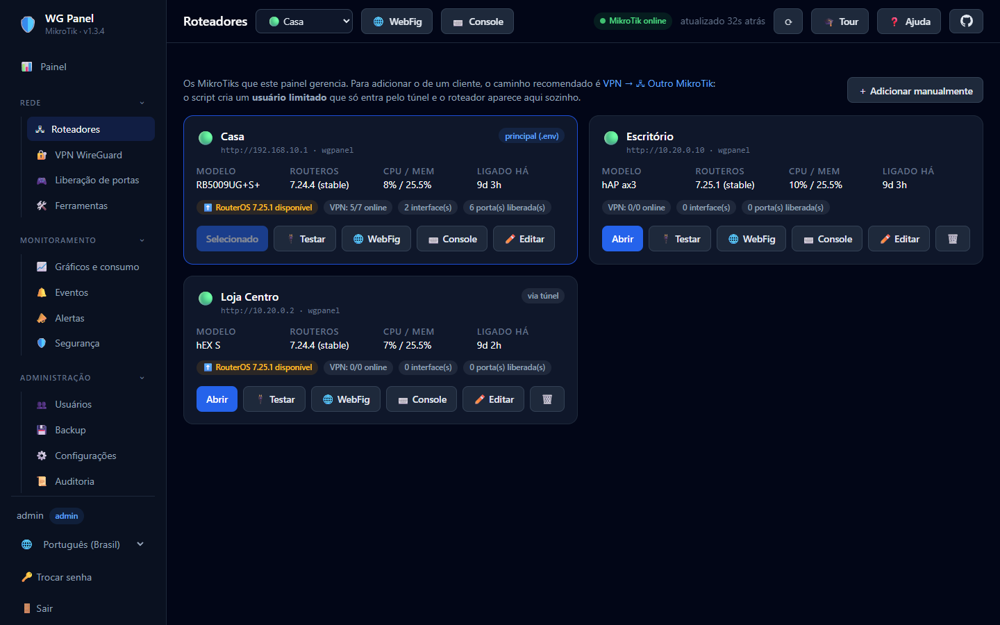</a><br><sub><b>Roteadores</b> — vários MikroTiks num painel só, aviso de atualização do RouterOS e WebFig</sub></td>
    <td width="50%" valign="top"><a href="docs/screenshots/pt-BR/console.png">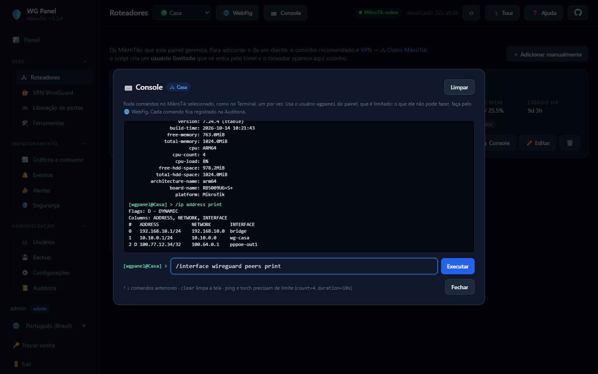</a><br><sub><b>Console</b> — comandos no MikroTik sem sair do painel, com o usuário limitado e registro na Auditoria</sub></td>
  </tr>
  <tr>
    <td width="50%" valign="top"><a href="docs/screenshots/pt-BR/site-to-site.png">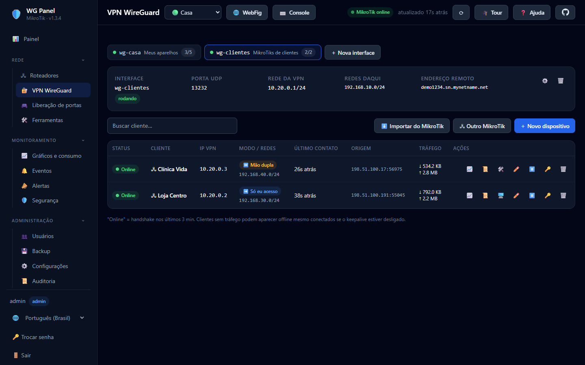</a><br><sub><b>Outro MikroTik (site-to-site)</b> — túneis com roteadores de clientes, só eu acesso ou mão dupla</sub></td>
    <td width="50%" valign="top"><a href="docs/screenshots/pt-BR/security.png">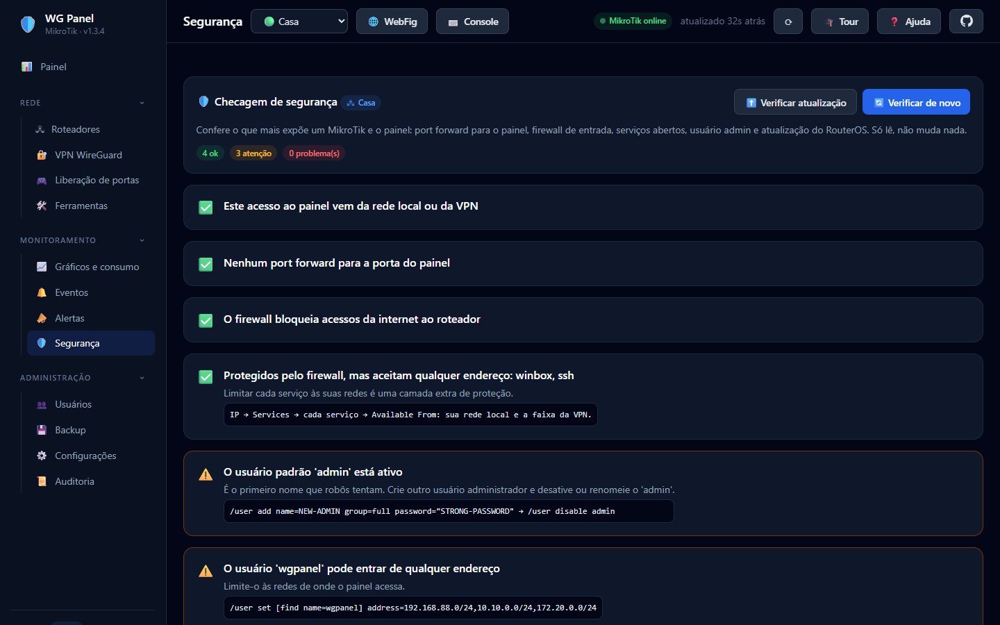</a><br><sub><b>Checagem de segurança</b> — os erros mais comuns em cada roteador, com o comando para corrigir</sub></td>
  </tr>
  <tr>
    <td width="50%" valign="top"><a href="docs/screenshots/pt-BR/port-forwarding.png">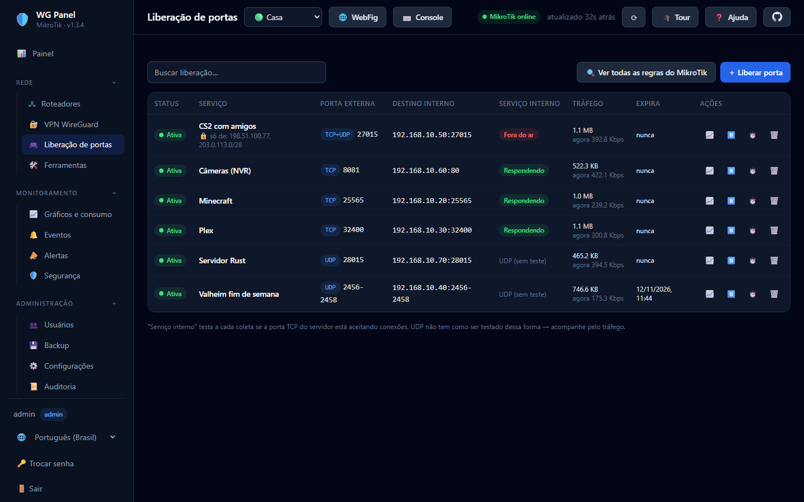</a><br><sub><b>Liberação de portas</b> — whitelist, liberação temporária e tráfego por porta</sub></td>
    <td width="50%" valign="top"><a href="docs/screenshots/pt-BR/new-port.png">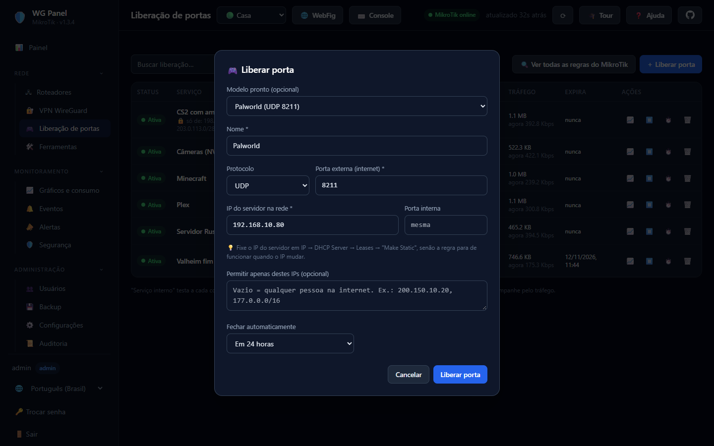</a><br><sub><b>Liberar porta</b> — modelos prontos para servidores de jogos e aplicações</sub></td>
  </tr>
  <tr>
    <td width="50%" valign="top"><a href="docs/screenshots/pt-BR/tools.png">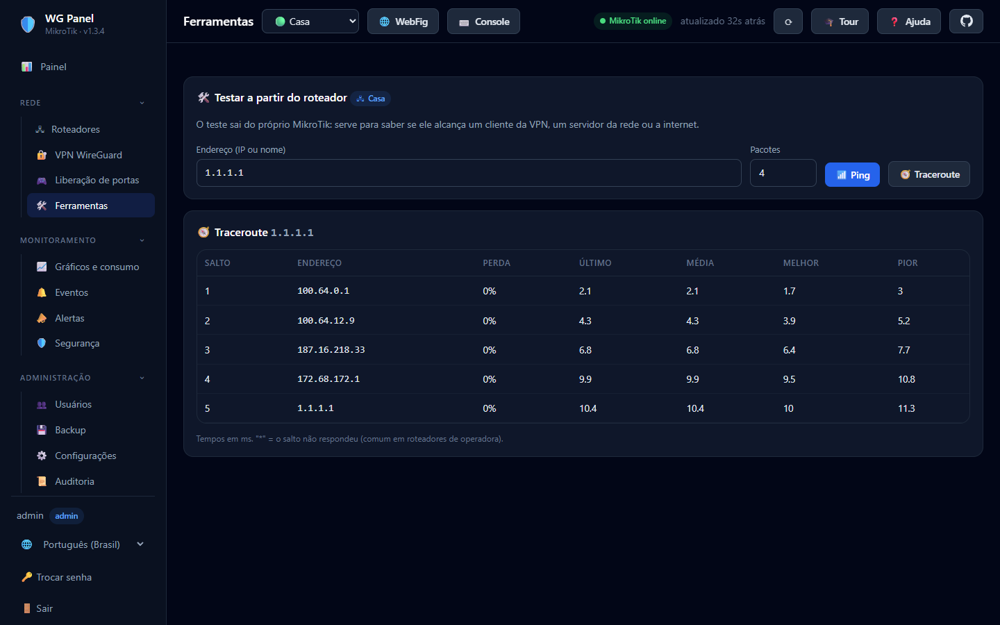</a><br><sub><b>Ferramentas</b> — ping e traceroute feitos pelo próprio MikroTik</sub></td>
    <td width="50%" valign="top"><a href="docs/screenshots/pt-BR/backup-diff.png">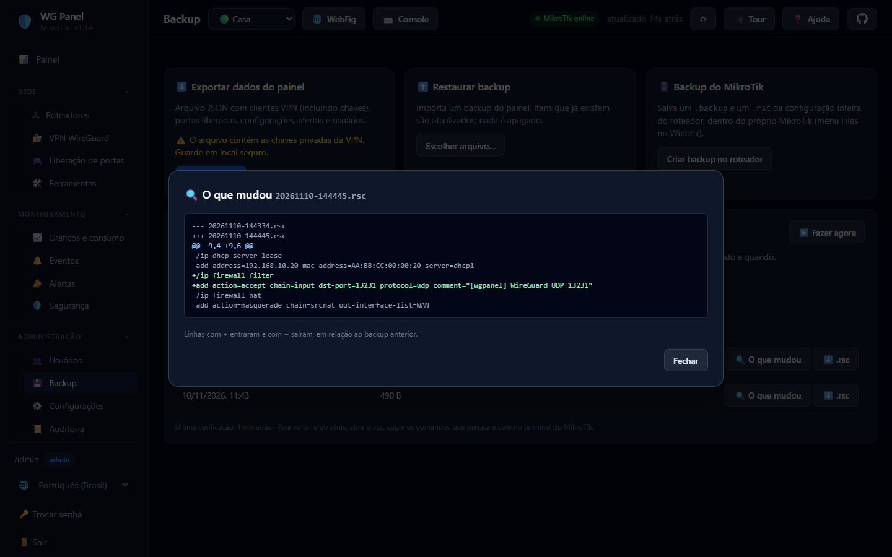</a><br><sub><b>Backup automático</b> — a configuração de cada MikroTik, guardada só quando muda, com o que mudou</sub></td>
  </tr>
  <tr>
    <td width="50%" valign="top"><a href="docs/screenshots/pt-BR/monitoring.png">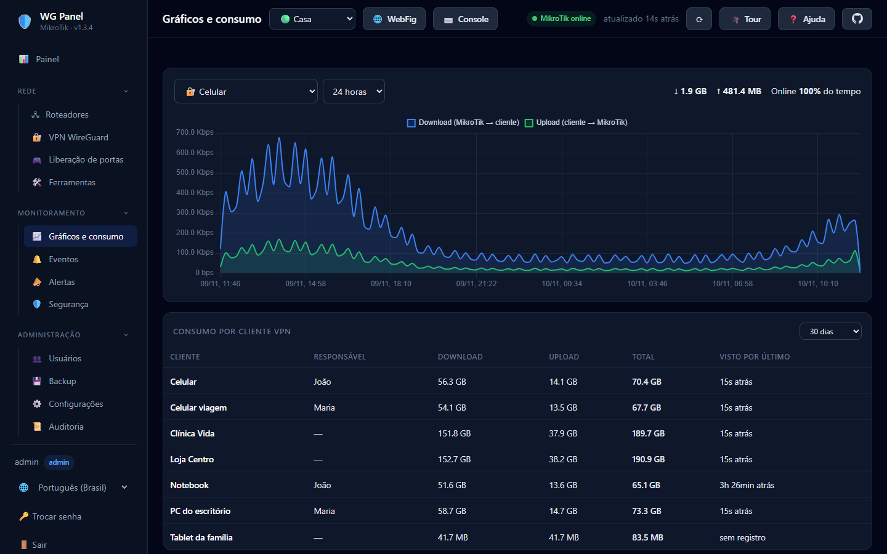</a><br><sub><b>Gráficos e consumo</b> — histórico de tráfego e consumo por cliente VPN</sub></td>
    <td width="50%" valign="top"><a href="docs/screenshots/pt-BR/alerts.png">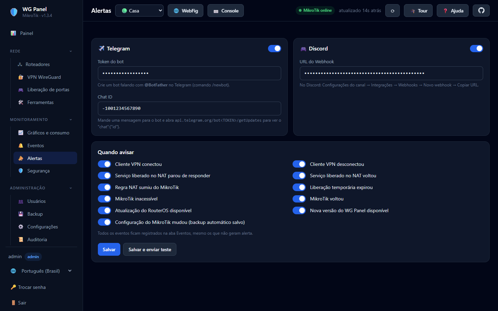</a><br><sub><b>Alertas</b> — Telegram e Discord, escolha quais eventos avisam</sub></td>
  </tr>
  <tr>
    <td width="50%" valign="top"><a href="docs/screenshots/pt-BR/settings.png">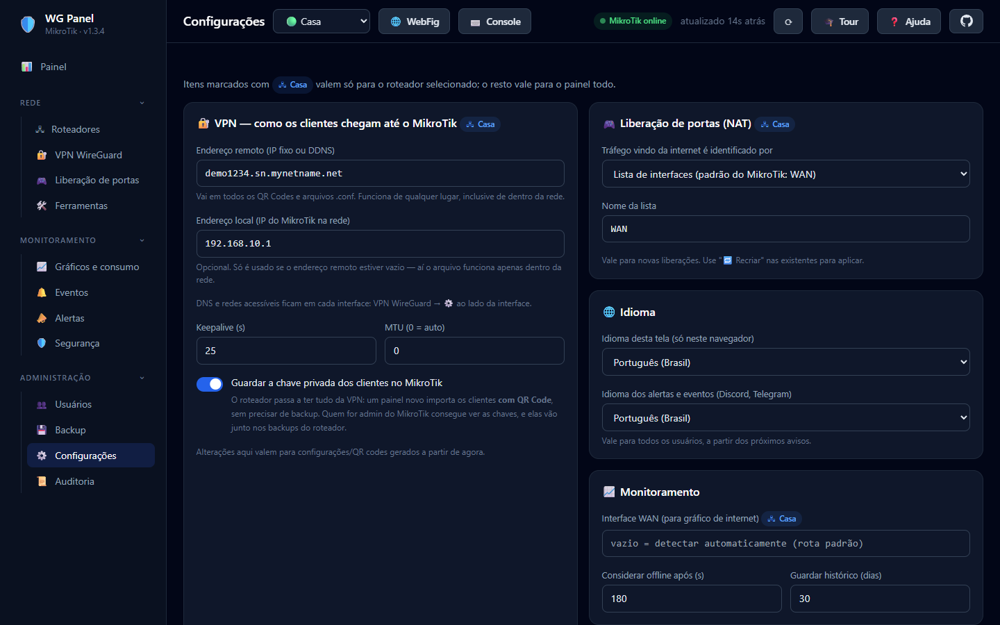</a><br><sub><b>Configurações</b> — opções por roteador e o idioma da tela e dos alertas</sub></td>
    <td width="50%" valign="top"><a href="docs/screenshots/pt-BR/events.png">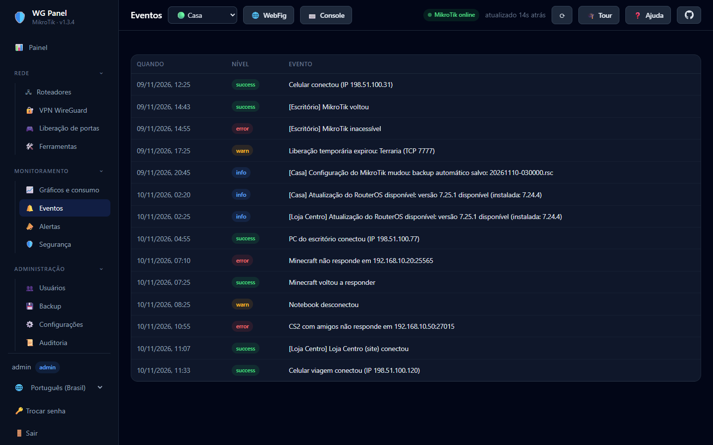</a><br><sub><b>Eventos</b> — tudo o que aconteceu, também enviado como alerta</sub></td>
  </tr>
  <tr>
    <td width="50%" valign="top"><a href="docs/screenshots/pt-BR/manual.png">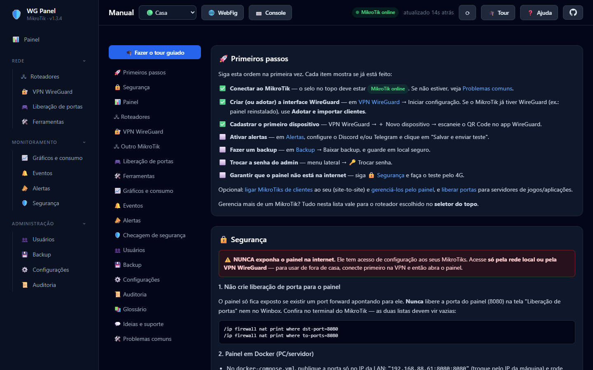</a><br><sub><b>Manual no painel</b> — cada tela explicada, em 9 idiomas</sub></td>
    <td width="50%" valign="top"></td>
  </tr>
</table>

<p align="center"><a href="docs/screenshots/pt-BR/mobile.png">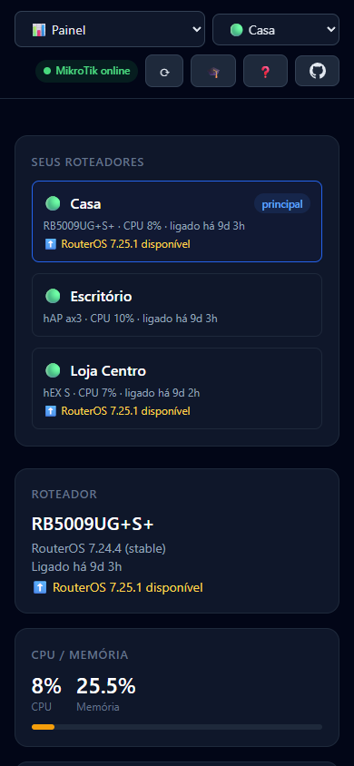</a>&nbsp;&nbsp;&nbsp;<a href="docs/screenshots/pt-BR/tour.png">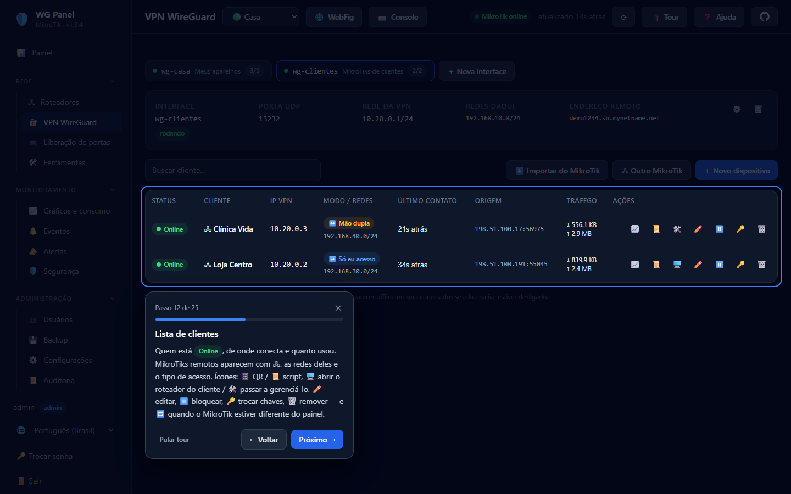</a><br><sub><b>Funciona no celular</b> · <b>Tour guiado</b> no primeiro acesso</sub></p>

---

## Escolha sua instalação

O painel roda de duas formas. As duas têm **exatamente as mesmas funções**; muda só onde ele fica ligado. Os arquivos prontos estão em **[Releases](../../releases/latest)**.

| | 🐳 **Docker** (PC, servidor, Raspberry Pi) | 🖧 **Container no MikroTik** |
|---|---|---|
| Onde roda | Em qualquer máquina com Docker, ligada 24h | Dentro do próprio roteador (RouterOS 7, ARM64 — ex.: RB5009) |
| Arquivo da Release | `wgpanel-docker-amd64-vX.Y.Z.tar.gz` + `docker-compose.yml` + `env.example` | `wgpanel-mikrotik-arm64-vX.Y.Z.tar` |
| Precisa de | Docker | Pacote `container` no RouterOS + pendrive/SSD USB |
| Alerta "MikroTik caiu" | ✅ Funciona (o painel fica fora do roteador) | ❌ Não existe (se o roteador cai, o painel cai junto) |
| Atualizar | Baixar a Release nova → `docker load` → `docker compose up -d` | Trocar a imagem do container (stop → remove → add → start) |
| Guia | [2. Subir o painel](#2-subir-o-painel) | [Rodar dentro do próprio MikroTik](#rodar-dentro-do-próprio-mikrotik-container) |

Nas duas formas, comece pelo [1. Preparar o MikroTik](#1-preparar-o-mikrotik-5-minutos).

---

## Como funciona

```
 Navegador ──► WG Panel (Docker) ──► API REST ──► MikroTik (RouterOS v7)
                    │
                    └─ a cada 30s coleta status/tráfego, guarda histórico e envia alertas
```

O painel usa a **API REST do RouterOS v7**. Não precisa instalar nada no roteador, só criar um usuário e ativar o serviço web.

---

## 1. Preparar o MikroTik (5 minutos)

Abra o **Winbox → New Terminal** e cole os comandos do arquivo [`mikrotik-setup.rsc`](mikrotik-setup.rsc), **trocando antes**:

- a senha do usuário `wgpanel`;
- `192.168.88.1` pelo IP do seu MikroTik;
- `192.168.88.0/24` pela sua rede local.

> 💡 Os comentários do arquivo estão em inglês. Os trechos que você precisa trocar estão marcados com `>>> <<<`, e a senha de exemplo é `change-this-password`.

O script faz o seguinte:

1. Cria o grupo `wgpanel` com as permissões mínimas de que o painel precisa.
2. Cria o usuário `wgpanel`.
3. Ativa a API REST via HTTPS (`www-ssl`), acessível **só da sua rede**.
4. Ativa o DDNS grátis do MikroTik (`xxxx.sn.mynetname.net`), útil se você não tem IP fixo.

> 💡 Se aparecer erro com `rest-api` no passo 1, sua versão é anterior à 7.9: remova `,rest-api` do comando.

Para conferir o endereço DDNS: `/ip cloud print` → campo `dns-name`.

---

## 2. Subir o painel

Requisito: **Docker** (Docker Desktop no Windows, ou Docker em qualquer Linux ou Raspberry Pi).

**Opção A — imagem pronta da Release (PC/servidor x86-64, mais rápido):** baixe `wgpanel-docker-amd64-vX.Y.Z.tar.gz` (X.Y.Z = versão), `docker-compose.yml` e `env.example` (renomeie para `.env`) da [Release mais recente](../../releases/latest) para uma pasta e rode:
```bash
docker load -i wgpanel-docker-amd64-v1.3.4.tar.gz     # use o nome exato do arquivo baixado
```

**Opção B — a partir do código** (qualquer máquina, inclusive Raspberry Pi): clone o repositório; o passo 2 abaixo usa `--build` para gerar a imagem.

```bash
# 1. Copie o arquivo de configuração e edite
cp .env.example .env        # no Windows: copy .env.example .env
```

Edite o `.env`:

```ini
MIKROTIK_URL=https://192.168.88.1      # IP do seu MikroTik
MIKROTIK_USER=wgpanel
MIKROTIK_PASSWORD=a-senha-que-voce-definiu
ADMIN_PASSWORD=uma-senha-forte-para-o-painel
```

```bash
# 2. Suba (Opção A: sem --build, usa a imagem carregada)
docker compose up -d --build

# 3. Veja os logs (se não definiu ADMIN_PASSWORD, a senha gerada aparece aqui)
docker compose logs -f
```

Acesse **http://IP-DO-COMPUTADOR:8080** e entre com `admin` e a senha.

> ⚠️ Deixe o painel acessível **só na rede local e pela VPN** — veja **[🔒 Segurança](#-segurança)** (não crie port forward para a porta 8080).

> O painel precisa ficar ligado para monitorar e enviar alertas. O ideal é rodar em algo 24h (mini PC, Raspberry Pi, servidor ou VPS). Se rodar no seu PC, o monitoramento para quando ele desligar, mas a VPN e as portas continuam funcionando, porque ficam no MikroTik.

---

## 3. Configurar a VPN

> **Painel novo ou reinstalado, mas o MikroTik já tem WireGuard?** A tela mostra **"Este MikroTik já tem WireGuard"** — clique em **Adotar e importar clientes** e a interface e os clientes voltam ao painel (com QR Code, se as chaves estiverem guardadas no MikroTik). Ou restaure um backup em **Backup → Restaurar**.

1. Vá em **VPN WireGuard → Iniciar configuração**.
2. O assistente já sugere os valores:
   - **Porta UDP** (padrão 13231).
   - **Faixa da VPN** (padrão `10.10.0.1/24`). Use uma faixa que **não** exista na sua rede.
   - **Endereço remoto:** seu IP fixo ou DDNS. É ele que vai no QR Code e no `.conf`.
   - **Endereço local** (opcional): IP do MikroTik na rede. Só é usado se o endereço remoto ficar vazio.
3. Clique em **Aplicar no MikroTik**. O painel cria a interface, o IP e a regra de firewall, e coloca a VPN na lista LAN.
4. Clique em **Novo cliente**, dê um nome e escaneie o QR Code com o app **WireGuard**.

### Endereço no QR Code

O QR Code e o `.conf` sempre usam o **endereço remoto** (IP fixo ou DDNS). Ele funciona de qualquer lugar: no 4G, em outra casa, no trabalho e, normalmente, também dentro da própria rede.

Se o roteador não tiver endereço remoto configurado, o painel usa o IP interno do MikroTik e avisa que o arquivo só funciona dentro da rede. Para corrigir, preencha o endereço remoto em **Configurações** e gere o QR de novo.

### Só rede local × Toda a internet

- **Só rede local** (split tunnel): o dispositivo acessa sua rede (NAS, câmeras, servidores) e a internet continua saindo pela conexão dele. Mais rápido.
- **Toda a internet** (full tunnel): todo o tráfego sai pelo seu MikroTik. Bom para Wi-Fi público.

---

## 4. Liberar portas (servidor de jogos/aplicações)

1. **Fixe o IP do servidor:** IP → DHCP Server → Leases → clique no servidor → **Make Static**.
2. **Liberação de portas → Liberar porta**, escolha um **modelo pronto** (ou preencha manualmente) e informe o IP do servidor.
3. Opcional:
   - **Whitelist:** só os IPs informados conseguem acessar (ótimo para RDP/SSH ou servidor entre amigos).
   - **Fechar automaticamente:** por exemplo, liberar só para a jogatina do fim de semana.
   - **Monitorar se está no ar:** o painel testa a porta TCP e alerta se o servidor cair.

> ⚠️ **CGNAT:** se a sua operadora usa CGNAT (o IP da WAN do MikroTik começa com `100.64` a `100.127`, ou é diferente do IP que aparece em sites como "meu ip"), liberação de porta e VPN de entrada **não funcionam**. Peça um IP público à operadora (muitas fornecem de graça ao pedir).

### Configuração do NAT (Configurações → Liberação de portas)

| Modo | Quando usar |
|---|---|
| **Lista de interfaces (WAN)** | Padrão do MikroTik (configuração de fábrica). Recomendado. |
| **Interface específica** | Se você não usa a lista WAN; informe `ether1`, `pppoe-out1` etc. |
| **Destino = IP do roteador** | Funciona também de dentro da rede acessando pelo IP público (para hairpin completo, crie também uma regra de masquerade). |

---

## 5. Alertas no Discord e Telegram

**Discord:**
1. No servidor, abra Configurações do canal → **Integrações → Webhooks → Novo webhook → Copiar URL**.
2. No painel, vá em **Alertas → Discord**, cole a URL, ative e clique em **Salvar e enviar teste**.

**Telegram:**
1. Fale com o **@BotFather** → `/newbot` → copie o **token**.
2. Mande qualquer mensagem para o seu bot.
3. Abra `https://api.telegram.org/bot<TOKEN>/getUpdates` e copie o número em `"chat":{"id": ...}`.
4. No painel, vá em **Alertas → Telegram**, preencha, ative e clique em **Salvar e enviar teste**.

Escolha quais eventos geram alerta. Todos ficam registrados na aba **Eventos**.

---

## Backup e atualização

- **Backup do painel:** aba **Backup → Baixar backup**. Contém as chaves privadas da VPN, então guarde em local seguro.
- **Backup automático do MikroTik:** ligado por padrão. Todo dia (ou semana) o painel exporta a configuração de cada roteador (sem senhas) para `data/router-backups/` e guarda uma cópia só quando algo mudou. Veja e compare em **Backup → 🕒 Backup automático do MikroTik**.
- **RouterOS 7 mais antigo?** Se o backup automático mostrar "precisa da permissão 'ftp'", o seu RouterOS não consegue mandar a exportação direto; o painel mostra o comando de uma linha que resolve (`ftp` é só acesso a arquivos — **não** liga o serviço FTP).
- **Dados ficam em** `./data` (banco SQLite + `secret.key`). Copie essa pasta para fazer backup completo. **Sem o `secret.key` as chaves salvas não podem ser lidas** (a não ser que você restaure pelo JSON exportado).
- **Atualizar o painel:** baixe a Release nova e rode `docker load -i wgpanel-docker-amd64-vX.Y.Z.tar.gz` e `docker compose up -d` (ou, a partir do código, `docker compose up -d --build`). O banco é migrado sozinho.
- **Reinstalar ou trocar de máquina:** restaure o backup em **Backup → Restaurar** (traz tudo). Sem backup, em **VPN WireGuard** use **Adotar e importar clientes**: a interface e os clientes voltam do próprio MikroTik.

---

## Problemas comuns

| Sintoma | Causa provável |
|---|---|
| "MikroTik offline" | `MIKROTIK_URL` errado, serviço `www-ssl`/`www` desativado, ou `address=` do serviço não inclui o IP do computador do painel |
| "Usuário ou senha do MikroTik inválidos" | Senha no `.env` ou grupo sem `rest-api`/`api` |
| Cliente VPN conecta mas não navega | Desmarcou "tratar VPN como LAN" no assistente, ou o firewall tem regras próprias que bloqueiam; marque e reaplique em **Reconfigurar** |
| VPN funciona em casa mas não fora | Roteador sem endereço remoto (o QR mostra o aviso de IP interno), CGNAT, ou porta UDP bloqueada pela operadora |
| Porta liberada não funciona | IP do servidor mudou (faça o lease estático), firewall do Windows do servidor bloqueando, ou CGNAT |
| "Ausente no MikroTik" | Alguém apagou a regra/peer direto no Winbox; clique em 🔁 **Recriar** |
| Container: o roteador Principal aparece como `http://192.168.88.1` | As variáveis do container sumiram ou não foram lidas. Veja [O pendrive morreu](#o-pendrive-morreu-ou-o-painel-sumiu-reinstalar-o-container) |
| Container: "Usuário ou senha inválidos" no login do painel | O usuário do painel é `admin`, não `wgpanel` (esse é o do MikroTik). O `ADMIN_PASSWORD` só vale quando a pasta de dados está vazia |

---

## Rodar dentro do próprio MikroTik (container)

Testado em um **RB5009 com RouterOS 7.24.4**: o painel usa ~60 MB de RAM e a imagem tem ~30 MB. É preciso um **pendrive ou SSD USB** (a flash interna não aguenta gravação constante).

> Desvantagem: se o roteador travar, o painel cai junto, então não existe o alerta "MikroTik inacessível".

**1. Pegar a imagem ARM64:** baixe `wgpanel-mikrotik-arm64-vX.Y.Z.tar` da [Release mais recente](../../releases/latest) (X.Y.Z = versão) — ou gere a partir do código (no PC, com Docker):
```bash
bash scripts/build-release.sh   # cria dist/release/wgpanel-mikrotik-arm64-vX.Y.Z.tar (e a versão Docker)
```

**2. Preparar o roteador** (terminal, usuário administrador):
```
/system device-mode update container=yes          # confirme apertando o botão/reiniciando, se pedir
/tool fetch url="https://download.mikrotik.com/routeros/<VERSÃO>/container-<VERSÃO>-arm64.npk"
/disk format usb1 file-system=ext4 label=wgpanel  # APAGA o pendrive
/system reboot                                    # reinicie pelo comando, não pela tomada
```

**3. Rede do container:**
```
/interface bridge add name=containers
/ip address add address=172.20.0.1/24 interface=containers
/interface veth add name=veth-wgpanel address=172.20.0.2/24 gateway=172.20.0.1
/interface bridge port add bridge=containers interface=veth-wgpanel
/interface list member add list=LAN interface=containers
/ip service set www-ssl available-from=192.168.88.0/24,10.10.0.0/24,172.20.0.0/24
```

**4. Configuração** (troque as senhas):
```
/container config set tmpdir=usb1/tmp
/container envs add list=wgpanel key=MIKROTIK_URL value=https://172.20.0.1
/container envs add list=wgpanel key=MIKROTIK_USER value=wgpanel
/container envs add list=wgpanel key=MIKROTIK_PASSWORD value="SENHA-DO-WGPANEL"
/container envs add list=wgpanel key=ADMIN_PASSWORD value="SENHA-DO-PAINEL"
/container envs add list=wgpanel key=POLL_INTERVAL value=60
/container mounts add list=wgpanel src=usb1/wgpanel/data dst=/data
```

**5. Enviar e iniciar:** arraste o `.tar` para o `usb1` na janela **Files** do Winbox e rode o comando abaixo, **trocando `1.3.4` pela versão do arquivo** (ela vai no nome do arquivo e no comentário do container):
```
/container add name=wgpanel file=usb1/wgpanel-mikrotik-arm64-v1.3.4.tar comment="WG Panel v1.3.4" interface=veth-wgpanel root-dir=usb1/wgpanel/root envlists=wgpanel mountlists=wgpanel dns=172.20.0.1 start-on-boot=yes logging=yes memory-max=256M
/container start wgpanel      # quando /container print mostrar que terminou de extrair
```
O `/container print` passa a mostrar a versão no comentário, e o painel mostra a versão no menu lateral (embaixo de "WG Panel").
Acesse **http://172.20.0.2:8080** (só pela rede local ou VPN — adicione a regra do [SECURITY.pt-BR.md](SECURITY.pt-BR.md), item 3). Para levar os dados de um painel existente: **Backup → Baixar** no antigo, **Backup → Restaurar** no novo (traz tudo). Se só precisar da VPN, abra **VPN WireGuard** no painel novo e clique em **Adotar e importar clientes** — com a opção "Guardar a chave privada no MikroTik" ligada, eles vêm com QR Code. Desligue o antigo para não receber alertas em dobro.

**Atualizar para uma versão nova** (os dados ficam em `usb1/wgpanel/data` e não são apagados):
```
/container stop wgpanel
/container remove wgpanel
/file remove [find name~"usb1/wgpanel-mikrotik-arm64"]
```
Arraste o `.tar` novo (ex.: `wgpanel-mikrotik-arm64-v1.3.4.tar`) para o `usb1` e rode o `/container add …` do passo 5 com a versão nova no nome do arquivo e no comentário; depois `/container start wgpanel`. Confira a versão no menu lateral do painel.

> Em RouterOS anterior à 7.20, troque `available-from` por `address`, e `list=`/`envlists=`/`mountlists=` por `name=`/`envlist=`/`mounts=`.

### O pendrive morreu (ou o painel sumiu): reinstalar o container

**O que se perde e o que fica:** a VPN, os clientes WireGuard e as regras de NAT ficam no próprio MikroTik e **continuam funcionando**. No pendrive ficam só a imagem do container e o banco do painel (usuários, alertas, roteadores de clientes). A rede do container (bridge `containers`, `veth-wgpanel`) fica no roteador.

> ⚠️ Já aconteceu de as variáveis (`/container envs`) e a pasta de dados (`/container mounts`) **sumirem do roteador** junto com o pendrive (possivelmente numa atualização do RouterOS). Sem o mount, o painel grava o banco dentro do container e perde tudo ao ser recriado. Por isso o passo 2 confere tudo.

**1. Formatar o pendrive novo** (confira o nome com `/disk print`):
```
/disk format usb1 file-system=ext4 label=wgpanel   # APAGA o pendrive
/container config set tmpdir=usb1/tmp
```

**2. Conferir variáveis e mount:**
```
/container envs print
/container mounts print
```
Se vierem vazios (ou incompletos), recrie. Comece limpando para não duplicar:
```
/container envs remove [find list=wgpanel]
/user set wgpanel password="SENHA-DO-WGPANEL"      # a mesma do MIKROTIK_PASSWORD abaixo
/container envs add list=wgpanel key=MIKROTIK_URL value=https://172.20.0.1
/container envs add list=wgpanel key=MIKROTIK_USER value=wgpanel
/container envs add list=wgpanel key=MIKROTIK_PASSWORD value="SENHA-DO-WGPANEL"
/container envs add list=wgpanel key=ADMIN_PASSWORD value="SENHA-DO-PAINEL"
/container envs add list=wgpanel key=POLL_INTERVAL value=60
/container mounts add list=wgpanel src=usb1/wgpanel/data dst=/data   # só se não existir
```
- `MIKROTIK_URL` é o endereço do serviço `www-ssl` **visto de dentro do container**. Se você mudou a porta, acrescente-a (ex.: `https://172.20.0.1:8443`). Confira com `/ip service print where name~"www"` e veja se `172.20.0.0/24` está no `available-from`.
- Use senhas só com letras e números enquanto testa; troque depois.

**3. Recriar o container** (ele só lê variáveis e mounts quando é criado):
```
/container stop wgpanel
/container print          # repita até aparecer "stopped" — antes disso o remove falha com "cannot remove running"
/container remove wgpanel
/file remove usb1/wgpanel/root
```
Arraste o `.tar` para o `usb1` (Winbox → **Files**) e rode o `/container add …` e o `/container start wgpanel` do passo 5 acima.

**4. Entrar e recuperar os dados:** abra **http://172.20.0.2:8080** com usuário **`admin`** e a senha do `ADMIN_PASSWORD`. Sem `ADMIN_PASSWORD`, o painel cria uma senha aleatória e mostra no log: `/log print where message~"senha"`.
- Tem backup do painel? **Backup → Restaurar** (traz tudo).
- Não tem? **VPN WireGuard → Adotar e importar clientes**: a interface e os clientes voltam do MikroTik (com QR Code, se "Guardar a chave privada no MikroTik" estava ligado). Usuários extras, alertas do Discord/Telegram e roteadores de clientes precisam ser cadastrados de novo.

> **Esqueceu a senha do painel?** O `ADMIN_PASSWORD` só é usado quando a pasta de dados está vazia. Para zerar: `/container stop wgpanel`, `/file remove usb1/wgpanel/data`, `/container start wgpanel` — isso **apaga a configuração do painel** (a VPN no MikroTik não é afetada).

**Para não perder de novo:** depois de tudo funcionando, baixe um backup (**Backup → Baixar backup**) e guarde fora do roteador; antes de atualizar o RouterOS, rode `/export file=antes-de-atualizar`. Prefira SSD USB ou pendrive "High Endurance" — pendrive comum se desgasta com a gravação constante.

---

## Rodar sem Docker (opcional)

```bash
python -m venv .venv
.venv/Scripts/activate        # Linux: source .venv/bin/activate
pip install -r requirements.txt
# defina as variáveis do .env no ambiente e então:
uvicorn app.main:app --host 0.0.0.0 --port 8080
```

Documentação da API: `http://IP:8080/api/docs`

## Estrutura

```
app/
  main.py                 # aplicação FastAPI
  mikrotik.py             # cliente da API REST do RouterOS (um por roteador)
  routerctx.py            # qual roteador a requisição está usando (seletor do painel)
  db.py                   # modelos (SQLite) e migrações automáticas
  routers/                # endpoints: mikrotiks (roteadores), wireguard, nat, monitor,
                          #            alerts, users, backup, settings, auth
  services/collector.py   # coleta periódica de todos os roteadores + histórico + alertas
  services/alerts.py      # Telegram / Discord
  services/nat_ops.py     # criação/remoção das regras de NAT
  services/router_ops.py  # remoção de roteadores do painel
  services/router_tools.py # ping, traceroute, checagem de segurança, exportação, atualização
  services/auto_tasks.py  # backups automáticos e verificação diária de atualização
  i18n.py + locales/      # mensagens do servidor em cada idioma
static/                   # interface web (Alpine.js + Tailwind + Chart.js)
  i18n.js + i18n/         # traduções das telas, do tour e do manual (um arquivo por idioma)
scripts/i18n_extract.py   # lista as frases que faltam em cada idioma
Dockerfile                # imagem Docker (PC/servidor)
Dockerfile.mikrotik       # imagem enxuta ARM64 para container no RouterOS
mikrotik-setup.rsc        # preparação do roteador
```

---

## 🔒 Segurança

> ### ⚠️ NUNCA exponha o painel na internet
> Ele tem acesso de configuração aos seus MikroTiks. Acesse **só pela rede local ou pela VPN WireGuard** — para usar de fora, conecte primeiro na VPN.

**Passo a passo para deixar o painel acessível só na rede local e pela VPN** (detalhes e comandos completos no **[SECURITY.pt-BR.md](SECURITY.pt-BR.md)**):

1. **Nunca crie liberação de porta (port forward) para o painel.** Confira no MikroTik que estas listas vêm vazias:
   ```
   /ip firewall nat print where dst-port=8080
   /ip firewall nat print where to-ports=8080
   ```
2. **Docker:** publique a porta só no IP da LAN (`"192.168.88.61:8080:8080"` no `docker-compose.yml`) e libere a porta no firewall da máquina só para a rede local e a faixa da VPN.
3. **Container no MikroTik:** adicione a regra que só deixa a LAN e a VPN chegarem em `172.20.0.2:8080` (comandos no SECURITY.pt-BR.md, item 3).
4. **Teste:** no celular, só com 4G e **sem VPN**, abra `http://SEU-DDNS:8080` — **não pode abrir**. Ligue a VPN e abra pelo IP interno — **deve abrir**.

Também: senha forte no `admin` do painel, usuário `wgpanel` limitado no MikroTik (nunca o admin), API do MikroTik restrita às suas redes e cuidado com `.env`, `data/` e backups. Falhas de segurança: relate em privado (veja SECURITY.pt-BR.md).

## 💬 Ideias, dúvidas e contribuições

- **[Discussions](../../discussions)** — ideias, perguntas de instalação/uso e troca de experiências.
- **[Issues](../../issues/new/choose)** — formulários para 💡 sugerir uma função ou 🐛 relatar um problema.
- **Pull requests** são bem-vindos. Para mudanças grandes, abra uma discussão antes.
- **Traduções:** cada idioma é um arquivo em `static/i18n/` (telas, tour e manual) e um em `app/locales/` (mensagens do servidor); a chave é o texto original em português. Rode `python scripts/i18n_extract.py` para ver o que falta em um idioma.

Ao relatar algo, **nunca cole senhas, chaves da VPN, o `.env` ou backups**.

## Licença e aviso

Distribuído sob a licença **[MIT](LICENSE)**.

Projeto independente, **não afiliado, patrocinado ou endossado pela MikroTik**. MikroTik, RouterOS, WebFig e Winbox são marcas da Mikrotīkls SIA. WireGuard é marca registrada de Jason A. Donenfeld. Use por sua conta e risco e faça backup do roteador antes de mudanças grandes.
